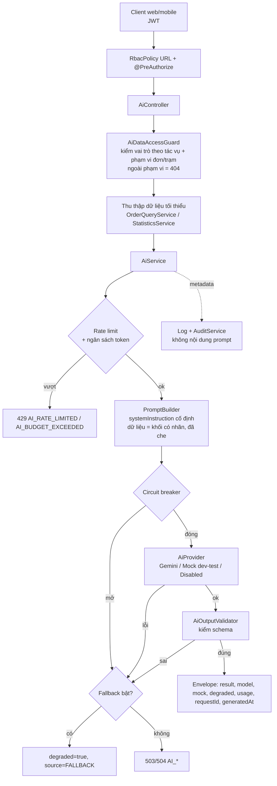

# AI Service (task 7.1, APDDMP-51)

Trạng thái: thiết kế + khung code. Chưa có logic ETA/tóm tắt/chat/phân tích thật (thuộc 7.2–7.6).

## 1. Quyết định kiến trúc

| Tiêu chí | A. Module nội bộ trong monolith (chọn) | B. Dịch vụ Java tách riêng |
|---|---|---|
| Vận hành | Không thêm tiến trình, CI, deploy | Thêm 1 service, cấu hình, giám sát, phiên bản hợp đồng |
| Độ trễ | Gọi hàm, chỉ còn độ trễ của Gemini | Thêm 1 hop mạng nội bộ |
| Bảo mật secret | Khóa Gemini nằm trong 1 tiến trình đã có | Thêm một nơi giữ secret và một kênh nội bộ cần xác thực |
| Truy cập dữ liệu | Dùng lại `OrderQueryService`/`StatisticsService` đã có phạm vi quyền | Phải xây API dữ liệu riêng hoặc cho đọc DB, dễ lệch quyền |
| Khả năng tách sau | Tốt nếu giữ ranh giới (xem mục 3) | Sẵn |
| Phù hợp quy mô dự án | Phù hợp: lượng gọi thấp (bị chặn bởi hạn mức gói miễn phí) | Thừa |

**Chọn A**, với ranh giới đủ rõ để tách sau mà không đổi hợp đồng. "API nội bộ" gồm: interface Java (`AiProvider`, `AiService`) và REST `/v1/ai/**` cho web/mobile. `/v1/ai/**` chỉ nhận JWT người dùng; API key 5.4 (`/v1/integration/**`) không dùng được.

## 2. Luồng xử lý

## 3. Ranh giới module

Package `com.smartdrone.application.ai` (cùng `infrastructure/service/GeminiAiProvider`, `api/config/AiConfig`, `api/controller/AiController`).

- Phụ thuộc vào nghiệp vụ khác **chỉ** qua `AiDataAccessGuard`, và chỉ gọi `OrderQueryService`, `StatisticsService` (đã có `@PreAuthorize` và phạm vi). Không inject repository/entity của đơn, trạm, người dùng.
- Phần còn lại của hệ thống chỉ biết `AiService.run(...)` và `AiResult`.
- Muốn tách thành service riêng: thay `AiProvider` bằng client gọi service đó, hoặc chuyển cả `AiService`; hợp đồng REST `/v1/ai/**` không đổi.
- Ngoại lệ có chủ đích: `AiService` dùng `AuditService` để ghi nhật ký thao tác AI (chỉ metadata).

## 4. Thành phần

| Thành phần | Vai trò |
|---|---|
| `AiTask` | ETA, ORDER_SUMMARY, CHAT, OPS_ANALYSIS; mỗi tác vụ có tập vai trò được phép |
| `AiProvider` | Cổng 1 hàm đồng bộ gọi nhà cung cấp |
| `GeminiAiProvider` | `RestClient`, không SDK; key ở header `x-goog-api-key`; retry ≤ 2 |
| `MockAiProvider` | Chỉ profile `dev/test/h2/demo`; mọi phản hồi `mock=true`, `source=MOCK` |
| `DisabledAiProvider` | Không có key: `AI_NOT_CONFIGURED` (hoặc fallback nếu bật) |
| `PromptBuilder` | Tách chỉ dẫn hệ thống khỏi dữ liệu; che dữ liệu nhạy cảm |
| `AiOutputValidator` | Kiểm schema JSON đầu ra theo từng tác vụ |
| `AiRateLimiter`, `AiBudget`, `AiCircuitBreaker` | Giới hạn tần suất, ngân sách token/ngày, ngắt mạch (in-memory) |
| `AiDataAccessGuard` | Kiểm quyền và phạm vi trước khi lấy dữ liệu |
| `AiService` | Facade cho 7.2–7.6 |

Chọn provider (`AiConfig`, `smartdrone.ai.provider=AUTO`): có `SMARTDRONE_AI_GEMINI_API_KEY` → Gemini; không có key và đang ở profile dev/test → Mock; ngoài ra → Disabled. Mock bị từ chối ngoài profile dev/test (rơi về Disabled).

## 5. Bảng mối đe dọa và biện pháp

| Mối đe dọa | Biện pháp |
|---|---|
| Prompt injection qua nội dung đơn/tin nhắn | Chỉ dẫn ở `systemInstruction` riêng; dữ liệu ở `contents` trong khối `<<DATA:nhãn>>…<<END_DATA>>`, dấu phân cách bị vô hiệu trong dữ liệu; chỉ dẫn cố định không nhận tham số dữ liệu; kiểm schema đầu ra; không thực thi gì từ đầu ra AI |
| Xem dữ liệu đơn của người khác qua AI | `AiDataAccessGuard` đi qua `OrderQueryService` (cùng phạm vi 3.7); đơn ngoài phạm vi và không tồn tại đều 404; kiểm trước khi gọi provider |
| Lộ dữ liệu cá nhân ra nhà cung cấp | Chỉ gửi dữ liệu tối thiểu (không email, SĐT, tên/địa chỉ người nhận, mã nhận hàng); `PersonalDataRedactor`; `smartdrone.ai.send-personal-data=false` mặc định |
| Lộ provider key | Chỉ từ biến môi trường; không trong yml, URL, log, response; `toString` không in key |
| Nhầm với API key 5.4 | Hai cơ chế tách hẳn: `/v1/ai/**` nằm ở chain JWT, không đọc `X-Api-Key` |
| Lạm dụng/tốn hạn mức | Rate limit theo người dùng và toàn hệ thống, ngân sách token/ngày, giới hạn độ dài tin nhắn và khối dữ liệu |
| Nhà cung cấp lỗi/chậm | Timeout kết nối + đọc, retry có giới hạn, ngắt mạch, fallback hoặc lỗi chuẩn (không 500, không treo) |
| Kết quả mock bị coi là AI thật | `mock=true`, `source=MOCK`; Mock không tồn tại ngoài dev/test |
| Lộ chi tiết lỗi nhà cung cấp | Lỗi được map sang `AI_*`; thân lỗi Google không bao giờ trả ra |
| Phi chuẩn nhật ký | Log/audit chỉ ghi task, userId, requestId, kết quả, model, token, độ trễ |

## 6. Cảnh báo dữ liệu gói miễn phí

> Với gói miễn phí của Gemini API, Google có thể dùng dữ liệu gửi lên để cải thiện sản phẩm. Vì vậy:
> - chỉ gửi dữ liệu tối thiểu đã che; giữ `smartdrone.ai.send-personal-data=false`;
> - **không dùng gói miễn phí với dữ liệu khách thật**; chuyển sang gói trả phí (điều khoản dữ liệu khác) trước khi chạy thật;
> - đối chiếu điều khoản hiện hành của Google trước khi triển khai (điều khoản có thể đổi).

## 7. Giới hạn đã biết

- Rate limit, ngân sách và ngắt mạch nằm trong bộ nhớ: đúng cho **một** instance, mất khi khởi động lại. Nhiều instance cần bộ đếm tập trung (Redis...).
- Mọi giá trị mặc định về hạn mức (5 yêu cầu/phút/người, 10/phút toàn hệ thống, 20 000 token/ngày/người, 200 000/ngày toàn hệ thống) là **ước lượng** thấp hơn gói miễn phí; phải đối chiếu trang rate limit trong AI Studio.
- Tên model mặc định `gemini-2.5-flash-lite` cần kiểm tra lại vì Google đổi tên/ngừng model thường xuyên.
- Hội thoại chat chưa được lưu (`conversationId` chỉ là mã tương quan); nơi lưu do 7.4 quyết định.
- Luồng thực tế `GeminiAiProvider` chưa được chạy với khóa thật trong test tự động; xem hướng dẫn thử thủ công trong `docs/07-testing/APDDMP-51-verification.md`.
