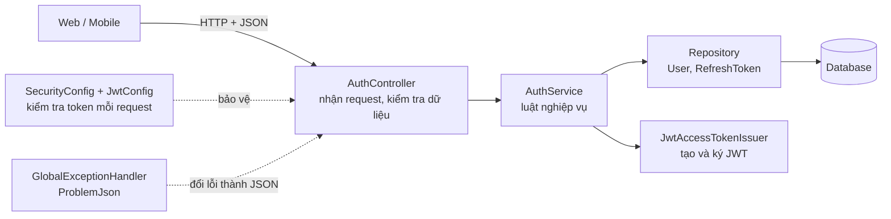
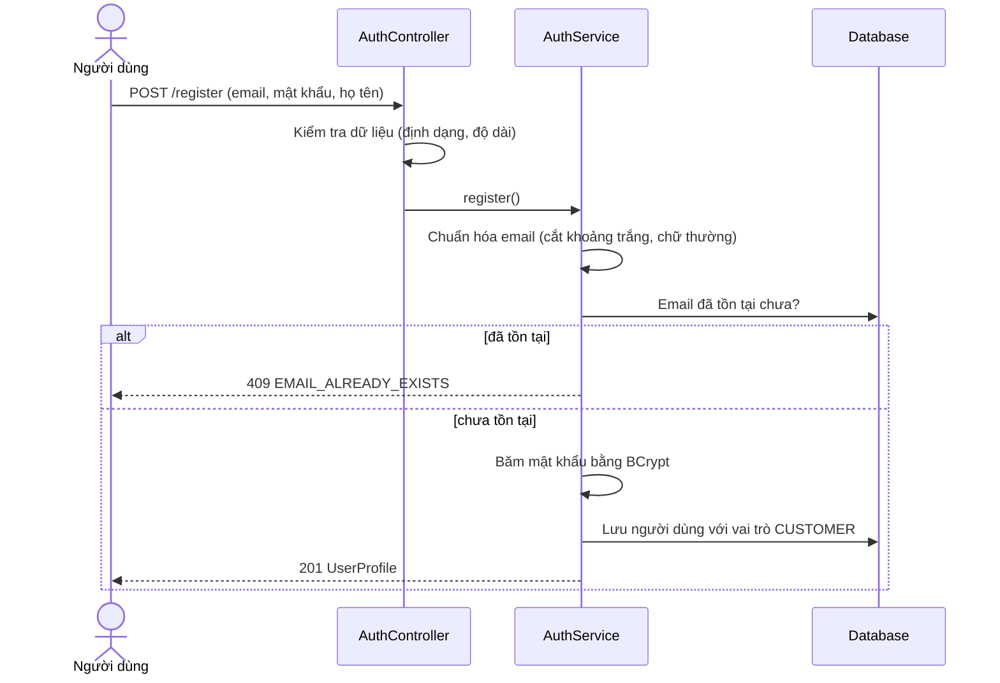
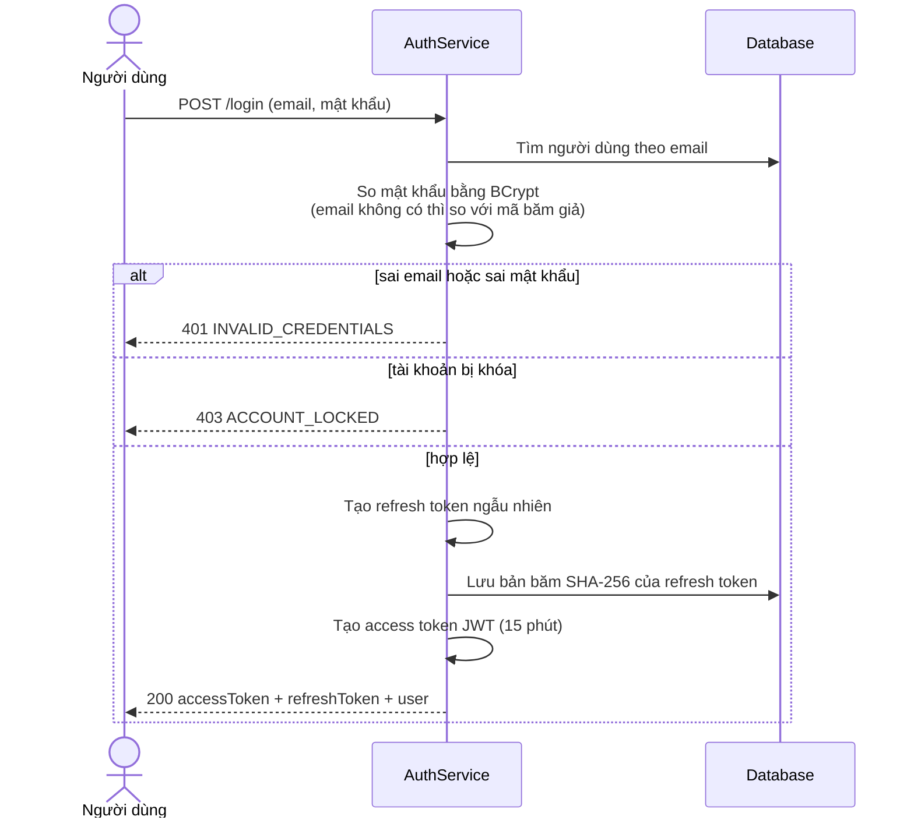
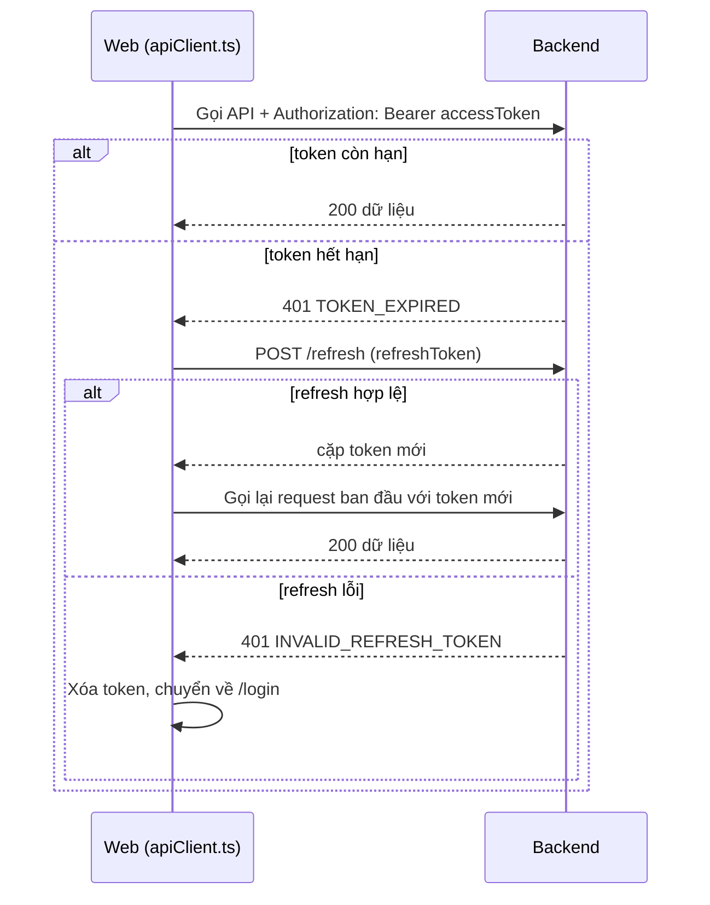
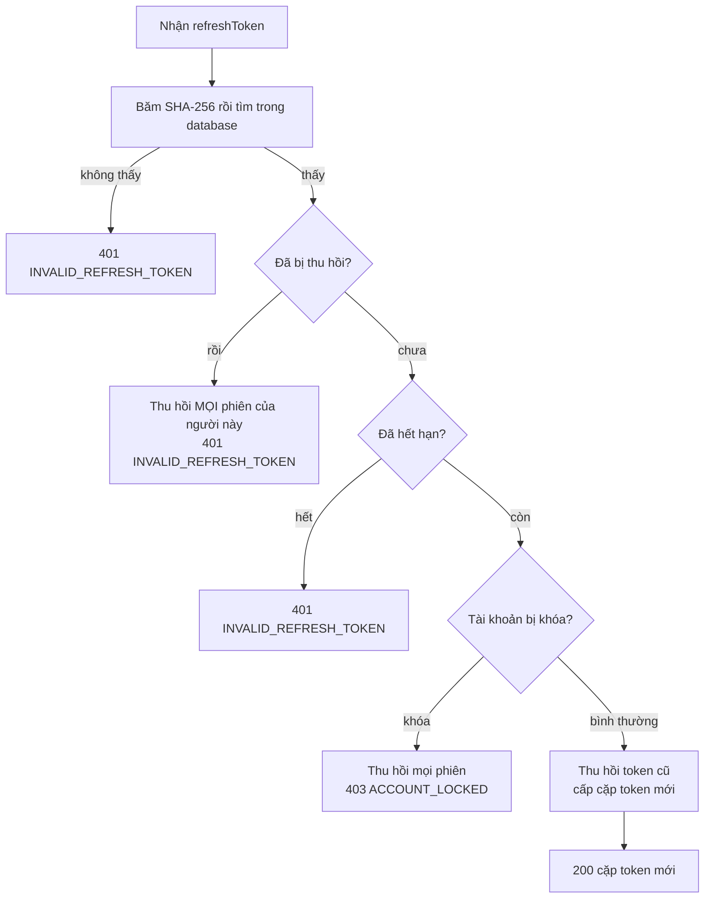

# Thiết kế xác thực — Task 2.5 (APDDMP-17)

## 1. Nghiệp vụ

Có 4 nghiệp vụ chính: **tạo tài khoản, đăng nhập, giữ phiên đăng nhập, và đăng xuất**.
Có **4 API** (đường dẫn gốc `/api/v1/auth`):

| API              | Việc làm                                | Kết quả                              |
| ---------------- | --------------------------------------- | ------------------------------------ |
| `POST /register` | Tạo tài khoản khách hàng                | `201` + thông tin người dùng         |
| `POST /login`    | Kiểm tra email, mật khẩu, cấp hai token | `200` + access token + refresh token |
| `POST /refresh`  | Đổi refresh token lấy cặp token mới     | `200` + cặp token mới                |
| `POST /logout`   | Hủy refresh token của thiết bị hiện tại | `204`                                |

**Bốn quyết định quan trọng nhất:**

1. **Đăng ký luôn là `CUSTOMER`.** Request không có trường vai trò, nên không ai tự phong mình làm Admin.
2. **Hai loại token.** Access token (JWT, sống 15 phút) để gọi API; refresh token (chuỗi ngẫu nhiên, sống 7 ngày, dùng một lần) để xin access token mới mà không phải nhập lại mật khẩu.
3. **Mật khẩu và refresh token không bao giờ được lưu nguyên bản.** Mật khẩu lưu bằng BCrypt, refresh token chỉ lưu mã băm SHA-256.
4. **Phát hiện đánh cắp token.** Nếu một refresh token đã dùng rồi bị gửi lại, hệ thống đăng xuất mọi thiết bị của người đó.

---

## 2. Phạm vi

| Đăng ký, đăng nhập, refresh, đăng xuất |
| Cấp và kiểm tra JWT |
| Lưu và thu hồi refresh token |
| Mã lỗi chuẩn cho phần xác thực |

---

## 3. Các khái niệm

| Thuật ngữ                | Giải nghĩa ngắn                                                                                                                                                                                                               |
| ------------------------ | ----------------------------------------------------------------------------------------------------------------------------------------------------------------------------------------------------------------------------- |
| **Access token**         | "Vé vào cổng" ngắn hạn (15 phút), gửi kèm mỗi request. Là một chuỗi JWT.                                                                                                                                                      |
| **JWT**                  | Chuỗi gồm 3 phần: tiêu đề, nội dung (người dùng, vai trò, hạn dùng) và chữ ký. Ai sửa nội dung thì chữ ký sai và bị từ chối. Nội dung chỉ được mã hóa dạng base64 nên **ai cũng đọc được**, vì vậy không đặt mật khẩu vào đó. |
| **Refresh token**        | "Vé đổi vé" dài hạn (7 ngày). Chỉ dùng để xin access token mới. Là chuỗi ngẫu nhiên 256 bit, không chứa thông tin.                                                                                                            |
| **Rotation (xoay vòng)** | Mỗi lần dùng refresh token thì nó bị hủy và được thay bằng cái mới.                                                                                                                                                           |
| **BCrypt**               | Cách băm mật khẩu cố tình chạy chậm và có thêm "muối" ngẫu nhiên, nên khó đoán mật khẩu bằng máy.                                                                                                                             |
| **SHA-256**              | Cách băm nhanh, dùng cho refresh token (đã ngẫu nhiên sẵn nên không cần chậm).                                                                                                                                                |
| **Stateless**            | Server không nhớ ai đang đăng nhập; mỗi request tự mang access token để chứng minh.                                                                                                                                           |
| **Thu hồi (revoke)**     | Đánh dấu một refresh token là đã vô hiệu, không xóa khỏi database, để còn phát hiện việc dùng lại.                                                                                                                            |

---

## 4. Kiến trúc

### 4.1 Các lớp và hướng gọi



Mỗi lớp chỉ làm một việc: **Controller** nhận và trả, **Service** quyết định, **Repository** nói chuyện với database, **Config** bảo vệ cổng vào, **Error** đổi lỗi thành JSON chuẩn.

### 4.2 Bản đồ file

Đường dẫn backend tính từ `backend/src/main/java/com/smartdrone/`.

| File                                                                                    | Vai trò                                                                     |
| --------------------------------------------------------------------------------------- | --------------------------------------------------------------------------- |
| `api/controller/AuthController.java`                                                    | 4 API. Chỉ gọi Service, không chứa nghiệp vụ.                               |
| `application/auth/AuthService.java`                                                     | Toàn bộ luật: đăng ký, đăng nhập, refresh, đăng xuất.                       |
| `application/auth/dto/RegisterRequest.java`, `LoginRequest.java`, `RefreshRequest.java` | Dữ liệu vào và luật kiểm tra (độ dài, định dạng).                           |
| `application/auth/dto/TokenResponse.java`, `UserProfile.java`                           | Dữ liệu trả ra. `UserProfile` không bao giờ có mật khẩu.                    |
| `application/auth/TokenHasher.java`                                                     | Sinh refresh token ngẫu nhiên và băm SHA-256.                               |
| `application/auth/AccessTokenIssuer.java`                                               | Giao diện "cấp access token".                                               |
| `infrastructure/service/JwtAccessTokenIssuer.java`                                      | Bản cài đặt: tạo và ký JWT bằng HS256.                                      |
| `application/auth/JwtProperties.java`                                                   | Đọc cấu hình `app.jwt.*` từ `application.yml`.                              |
| `domain/entity/RefreshToken.java`                                                       | Bảng `refresh_tokens`.                                                      |
| `infrastructure/persistence/RefreshTokenRepository.java`                                | Tìm refresh token (có khóa dòng) và thu hồi hàng loạt.                      |
| `api/config/JwtConfig.java`                                                             | Tạo bộ ký và bộ kiểm tra JWT; từ chối khóa ngắn hơn 32 ký tự.               |
| `api/config/SecurityConfig.java`                                                        | Quy định API nào công khai, API nào cần token; mã hóa mật khẩu bằng BCrypt. |
| `application/common/ErrorCode.java`, `ApiException.java`                                | Danh sách mã lỗi và ngoại lệ nghiệp vụ. Dùng chung với các task khác.       |
| `api/error/GlobalExceptionHandler.java`, `ProblemJson.java`                             | Biến lỗi thành JSON chuẩn (xem mục 8).                                      |
| `web/src/lib/authService.ts`, `apiClient.ts`, `token.ts`                                | Phía web: gọi API, tự refresh khi gặp 401, lưu token.                       |

---

## 5. Luồng hoạt động

### 5.1 Đăng ký



Hai điểm cần nhớ:

- Vai trò là `CUSTOMER` do server gán cứng. Nếu client gửi thêm `"role":"SYSTEM_ADMIN"` thì trường đó bị bỏ qua.
- Nếu hai người đăng ký cùng email cùng lúc, ràng buộc duy nhất của database chặn người thứ hai, và lỗi được đổi thành `409` thay vì `500`.

### 5.2 Đăng nhập



Hai chi tiết chống dò tài khoản:

- Sai email và sai mật khẩu trả **cùng một lỗi**, để kẻ xấu không biết email nào đã đăng ký.
- Khi email không tồn tại, hệ thống vẫn chạy BCrypt với một mã băm giả để thời gian phản hồi gần như nhau.
- `ACCOUNT_LOCKED` chỉ báo sau khi mật khẩu đúng.

### 5.3 Gọi API có bảo vệ và tự làm mới token (phía web)



Nếu nhiều request cùng gặp 401, web chỉ gọi `/refresh` **một lần** và cho các request chờ dùng chung kết quả. Lý do: refresh token chỉ dùng được một lần; gọi song song sẽ bị backend coi là dùng lại token và đăng xuất tất cả.

### 5.4 Quyết định bên trong `/refresh`



Nhánh "đã bị thu hồi" là phát hiện đánh cắp: người dùng thật và kẻ trộm cùng cầm một refresh token, người nào dùng sau sẽ bị phát hiện, và mọi phiên đều bị hủy để buộc đăng nhập lại.

### 5.5 Đăng xuất

`POST /logout` gửi kèm refresh token, backend thu hồi đúng token đó. Điểm đặc biệt:

- **Công khai**, không cần access token, vì khi người dùng bấm đăng xuất access token có thể đã hết hạn; refresh token chính là bằng chứng.
- **Idempotent**: token lạ hoặc đã thu hồi vẫn trả `204`, vì dù sao phía client cũng xóa token ở máy.

---

## 6. Các quyết định thiết kế và lý do

| Vấn đề                                           | Cách làm                                                                      | Vì sao                                                                                   |
| ------------------------------------------------ | ----------------------------------------------------------------------------- | ---------------------------------------------------------------------------------------- |
| Ai tự phong quyền?                               | `RegisterRequest` không có trường vai trò; server gán cứng `CUSTOMER`         | Chống leo thang đặc quyền                                                                |
| Lưu mật khẩu                                     | BCrypt, giới hạn 72 byte                                                      | BCrypt chỉ đọc 72 byte đầu nên phải chặn mật khẩu dài hơn để không bị cắt ngầm           |
| Lưu refresh token                                | Chỉ lưu SHA-256                                                               | Lộ database cũng không dùng lại được token                                               |
| Vì sao SHA-256 mà không BCrypt cho refresh token | Token đã ngẫu nhiên 256 bit; cần tìm theo giá trị băm                         | BCrypt cho kết quả khác nhau mỗi lần nên không tìm theo băm được                         |
| Hai loại token                                   | Access 15 phút, refresh 7 ngày                                                | Access token ngắn hạn thì lộ cũng ít hại; refresh token có thể thu hồi để đăng xuất thật |
| Refresh dùng một lần                             | Rotation, dùng lại thì hủy mọi phiên                                          | Phát hiện đánh cắp                                                                       |
| Hai request refresh cùng lúc                     | Khóa dòng khi đọc (`PESSIMISTIC_WRITE`)                                       | Hai request cùng token không thể cùng thành công                                         |
| Thu hồi khi phát hiện lỗi                        | `@Transactional(noRollbackFor = ApiException.class)`                          | Nếu không có, ném lỗi sẽ hoàn tác việc thu hồi, phát hiện đánh cắp thành vô tác dụng     |
| Chống dò email                                   | Cùng lỗi cho sai email và sai mật khẩu, so mã băm giả khi email không tồn tại | Không lộ email nào đã đăng ký, kể cả qua thời gian phản hồi                              |
| CSRF                                             | Tắt                                                                           | API dùng Bearer token trong header chứ không dùng cookie nên không dính CSRF             |
| Server nhớ phiên?                                | Không (stateless)                                                             | Mỗi request tự mang token, dễ mở rộng                                                    |
| Khóa ký JWT                                      | Biến môi trường `APP_JWT_KEY`, tối thiểu 32 ký tự, từ chối khởi động nếu ngắn | Không chạy với khóa yếu                                                                  |
| Kiểm tra token                                   | Chữ ký, hạn dùng, issuer, audience                                            | Token của hệ thống khác hoặc bị sửa đều bị từ chối                                       |
| Thời gian trong code                             | Tiêm `Clock` thay vì gọi giờ trực tiếp                                        | Test giả lập được thời gian                                                              |

---

## 7. Bảo mật: nguy cơ và cách phòng

| Nguy cơ                                   | Cách hệ thống phòng                                                             |
| ----------------------------------------- | ------------------------------------------------------------------------------- |
| Đoán mật khẩu bằng máy                    | BCrypt chậm; yêu cầu 8–72 ký tự có chữ và số                                    |
| Dò email đã đăng ký                       | Cùng một lỗi và cùng thời gian phản hồi                                         |
| Lộ database                               | Mật khẩu là BCrypt; refresh token là SHA-256; không trả `passwordHash` ra ngoài |
| Sửa JWT để đổi vai trò                    | Chữ ký HS256, sai là bị từ chối                                                 |
| Trộm refresh token                        | Rotation và phát hiện dùng lại                                                  |
| Token bị trình duyệt hoặc proxy lưu cache | `Cache-Control: no-store` trên login và refresh                                 |
| Tự phong Admin khi đăng ký                | Không nhận vai trò từ client                                                    |
| Gửi JWT của hệ thống khác                 | Kiểm tra `iss` và `aud`                                                         |

**Ghi chú quan trọng về phía web:** token lưu trong `localStorage`, nên nếu trang bị tấn công XSS thì script độc hại đọc được token. Đây là đánh đổi chấp nhận được cho đồ án; bản triển khai thật nên cân nhắc đặt refresh token trong cookie `HttpOnly`.

---

## 8. Mã lỗi và định dạng lỗi

Mọi lỗi trả về `application/problem+json`, có các trường `status`, `code` (ổn định, dành cho máy đọc), `message` (câu tiếng Việt cho người đọc), `traceId` (để tra log), và với lỗi dữ liệu có thêm `errors[]` theo từng trường. Bảng đầy đủ nằm ở mục 6 của [`auth-api.md`](../05-api/auth-api.md). Các mã liên quan đến xác thực:

| HTTP | Mã                      | Ý nghĩa                                |
| ---- | ----------------------- | -------------------------------------- |
| 400  | `VALIDATION_ERROR`      | Dữ liệu gửi lên sai luật               |
| 401  | `INVALID_CREDENTIALS`   | Sai email hoặc mật khẩu                |
| 401  | `INVALID_REFRESH_TOKEN` | Refresh token lạ, hết hạn hoặc đã dùng |
| 401  | `AUTH_REQUIRED`         | Thiếu hoặc sai access token            |
| 401  | `TOKEN_EXPIRED`         | Access token hết hạn                   |
| 403  | `ACCOUNT_LOCKED`        | Tài khoản bị khóa                      |
| 409  | `EMAIL_ALREADY_EXISTS`  | Email đã đăng ký                       |

Web nên dựa vào trường `code` để quyết định hành động, không dựa vào nội dung `message` (câu chữ có thể đổi).

---

## 9. Cấu hình và cách chạy

**Cấu hình trong `application.yml`** (nhóm `app.jwt`):

| Khóa                   | Giá trị mặc định               | Ý nghĩa                         |
| ---------------------- | ------------------------------ | ------------------------------- |
| `key`                  | `${APP_JWT_KEY:CHANGE_ME_...}` | Khóa bí mật ký JWT (≥ 32 ký tự) |
| `issuer`               | `SmartDrone`                   | Ai phát hành token              |
| `audience`             | `SmartDroneClients`            | Token dành cho ai               |
| `access-token-minutes` | `15`                           | Thời hạn access token           |
| `refresh-token-days`   | `7`                            | Thời hạn refresh token          |

> Khóa mặc định `CHANGE_ME_...` chỉ để chạy thử trên máy dev. **Khi triển khai thật bắt buộc đặt biến môi trường `APP_JWT_KEY`** thành một chuỗi ngẫu nhiên dài và không đưa vào repo.

**Chạy thử không cần cài PostgreSQL** (dữ liệu nằm trong RAM, mất khi tắt):

```bash
cd backend
mvn spring-boot:run -Dspring-boot.run.profiles=h2
```

**Thử bằng curl:**

```bash
# 1. Đăng ký (role gửi thêm sẽ bị bỏ qua)
curl -X POST http://localhost:5000/api/v1/auth/register \
  -H "Content-Type: application/json" \
  -d '{"email":"an@example.com","password":"Passw0rdOK","fullName":"Nguyen Van An"}'

# 2. Đăng nhập
curl -X POST http://localhost:5000/api/v1/auth/login \
  -H "Content-Type: application/json" \
  -d '{"email":"an@example.com","password":"Passw0rdOK"}'
```

Swagger UI: `http://localhost:5000/api/swagger-ui.html`.

---
