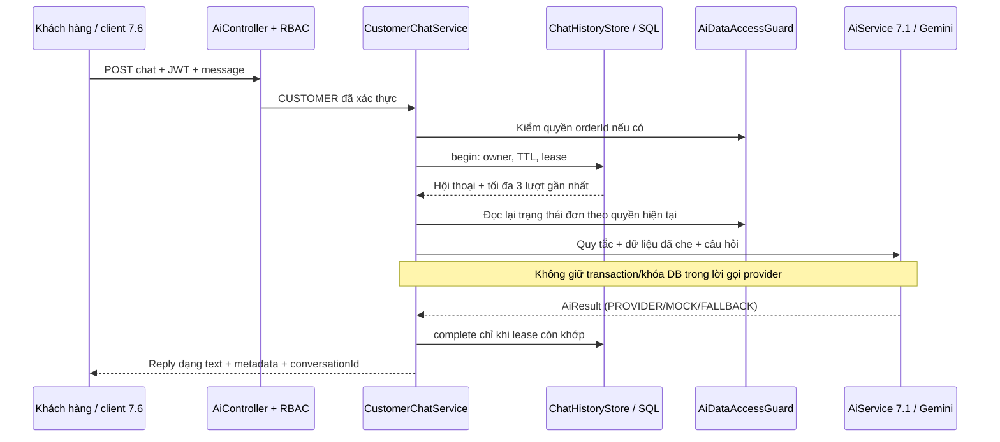

# Kiến trúc chat khách hàng — APDDMP-54

Phụ trách: Lê Công Nhã. Dựa trên AiService 7.1, không tách thêm dịch vụ hoặc đổi provider.

- Entity lưu lịch sử riêng theo owner; ID ngẫu nhiên không thay thế kiểm quyền.
- Giao dịch ngắn với pessimistic lock bảo vệ một hội thoại; lease chống ghi từ response cũ.
- AiService tiếp tục kiểm rate limit/ngân sách/circuit breaker/audit của 7.1.
- Chỉ CustomerChatService điều phối chat; không có repository ghi nghiệp vụ đơn hay công cụ model.
- Nguồn chính sách thương mại chưa có; danh mục ChatKnowledge là quy tắc chức năng có thể đối chiếu code.
- Giới hạn và rủi ro còn lại được ghi trong [hợp đồng API](../05-api/customer-ai-chat.md).
