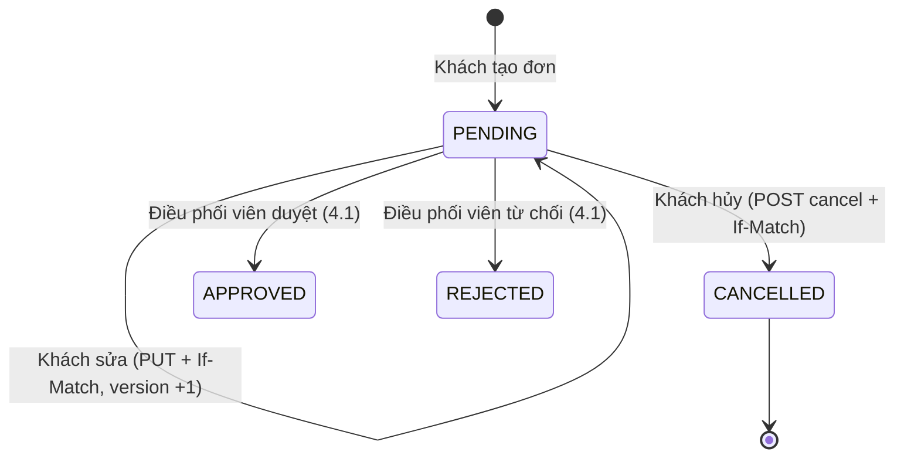

# 3.6 — Khách sửa và hủy đơn khi còn chờ duyệt

Nhánh: `feature/3.6-order-web-edit-cancel`. Backend Java Spring Boot không đổi trong thay đổi này; phần mới là giao diện React dùng API có sẵn.

## Nghiệp vụ

- Chỉ CUSTOMER sửa hoặc hủy được, và chỉ đơn **của chính mình**. Đơn của người khác trả 404, không phân biệt với đơn không tồn tại.
- Chỉ đơn ở trạng thái **PENDING** mới sửa hoặc hủy được. Từ APPROVED, REJECTED, CANCELLED trở đi, mọi thao tác của khách bị từ chối bằng 409.
- Sửa là **thay toàn bộ nội dung** (PUT): trạm gửi, trạm nhận, địa chỉ người nhận, gói hàng. Địa chỉ người nhận được sao chép lại thành bản ghi (snapshot) tại thời điểm sửa.
- Mỗi lần sửa tăng `version` thêm 1. Hủy chuyển PENDING → CANCELLED và cũng tăng `version`.
- Mọi thao tác ghi đều phải gửi `If-Match` bằng phiên bản đang xem, để hai người (hoặc hai tab) không ghi đè lẫn nhau.



## Hợp đồng HTTP

Base URL local: `http://localhost:5000/api`. Tất cả API cần Bearer token của CUSTOMER.

| API | Body | Header | Thành công |
|---|---|---|---|
| GET /v1/orders/{id} | Không | Authorization | 200 OrderDetail kèm `ETag: "<version>"` |
| PUT /v1/orders/{id} | `OrderRequest` (xem dưới) | Authorization, If-Match | 200 OrderView mới, `ETag` mới |
| POST /v1/orders/{id}/cancel | Không | Authorization, If-Match | 200 OrderView (status CANCELLED), `ETag` mới |

`OrderRequest`:

```json
{
  "pickupStationId": "32000000-0000-0000-0000-000000000001",
  "dropoffStationId": "32000000-0000-0000-0000-000000000002",
  "recipientAddressId": "<uuid địa chỉ của khách>",
  "package": {
    "description": "Hộp quà",
    "weightGrams": 1200,
    "lengthCm": 30,
    "widthCm": 20,
    "heightCm": 10,
    "photoFileIds": []
  }
}
```

Body không được chứa trường lạ (ví dụ `status`, `customerId`): server từ chối để khách không tự đổi trạng thái hay chủ đơn.

Quy ước `If-Match`: lấy từ header `ETag` của GET, ví dụ `ETag: "0"` thì gửi `If-Match: "0"`. Server chấp nhận cả dạng `W/"0"` và `0`.

| HTTP | Ý nghĩa | Cách web xử lý |
|---|---|---|
| 400 | Dữ liệu sai (trạm gửi trùng trạm nhận, trạm không hoạt động, thiếu trường, `If-Match` sai định dạng) | Hiện lỗi trên form, giữ nguyên dữ liệu đã nhập |
| 401 | Chưa đăng nhập hoặc phiên hết hạn | Về trang đăng nhập |
| 403 | Không phải CUSTOMER | Báo không còn quyền, yêu cầu tải lại |
| 404 | Đơn không tồn tại hoặc không phải của khách | Báo không tìm thấy hoặc không còn quyền, yêu cầu tải lại |
| 409 | Đơn không còn PENDING | Báo không thể thay đổi, yêu cầu tải lại |
| 412 | Sai phiên bản: đơn đã bị cập nhật ở nơi khác | Báo đơn đã thay đổi, nút **Tải lại đơn** |
| 428 | Thiếu `If-Match` | Yêu cầu tải lại đơn |

Lưu ý thứ tự kiểm tra khi sửa: server kiểm tra **phiên bản trước, trạng thái sau**. Vì vậy sửa một đơn đã hủy bằng phiên bản cũ trả 412; bằng phiên bản mới nhất (như web làm sau khi tải lại) trả 409.

Web không tự động thử lại sau lỗi mạng hoặc lỗi 5xx. Khi chưa chắc server đã ghi hay chưa, web yêu cầu tải lại đơn để biết kết quả trước khi cho thao tác tiếp.

## Phần giao diện

| File | Việc |
|---|---|
| `web/src/lib/orderErrors.ts` | Chuyển mã lỗi 412/428/409/403/404/5xx thành thông báo và cờ "phải tải lại" |
| `web/src/lib/orderService.ts` | Thêm `update`, `cancel`, `ifMatchOf` |
| `web/src/features/orders/OrderForm.tsx` | Form dùng chung cho tạo và sửa đơn |
| `web/src/features/orders/CreateOrderPage.tsx` | Tạo đơn, dùng `OrderForm` |
| `web/src/features/orders/EditOrderPage.tsx` | Sửa đơn, route `/deliveries/:id/edit` |
| `web/src/features/orders/OrderCustomerActions.tsx` | Khối Sửa đơn / Hủy đơn (có bước xác nhận hủy) |
| `web/src/features/orders/OrderDetailPage.tsx` | Hiện khối trên cho CUSTOMER khi đơn PENDING; đọc thông báo sau khi tạo/sửa |
| `web/src/routes/AppRouter.tsx` | Thêm route `/deliveries/:id/edit` |
| `web/src/index.css` | Màu cho 4 trạng thái: IN_TRANSIT, AWAITING_PICKUP, RETURNING, RETURNED |

Ghi chú về giao diện: nút Sửa/Hủy chỉ là tiện lợi. Quyền thật do backend kiểm tra độc lập ở mỗi request.

## Dùng giao diện

1. Đăng nhập tài khoản CUSTOMER thật (không dùng chế độ demo).
2. Mở **Đơn giao hàng**, chọn một đơn **Chờ duyệt**.
3. **Sửa đơn:** đổi nội dung, bấm *Xác nhận lưu thay đổi*; web quay về chi tiết kèm thông báo.
4. **Hủy đơn:** bấm *Hủy đơn* rồi *Xác nhận hủy*; có nút *Không hủy* trước khi gửi.
5. Sau khi hủy, nhãn đơn thành **Đã hủy** và khối Sửa/Hủy biến mất.
6. Mở cùng một đơn ở hai tab: tab thao tác sau nhận cảnh báo và nút **Tải lại đơn**.

## Kiểm thử

Xem [báo cáo kiểm chứng 3.6](../07-testing/3.6-edit-cancel-verification.md).

```powershell
# Trong web
npx tsc --noEmit
npm run build
```