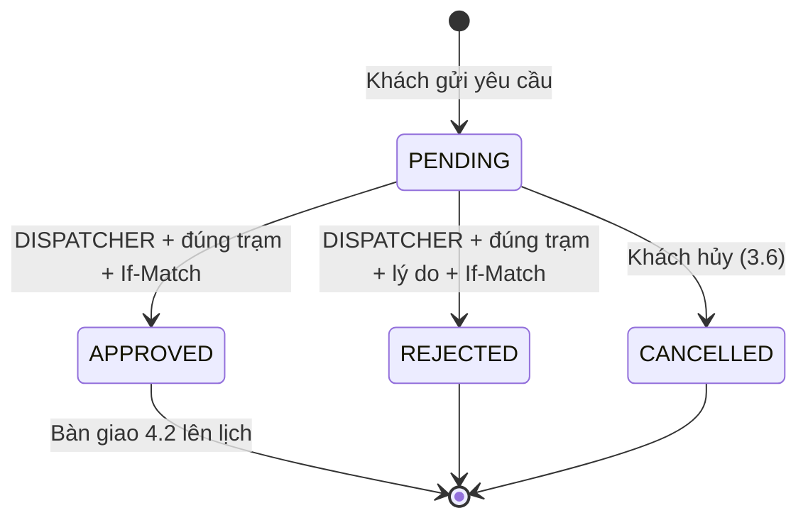
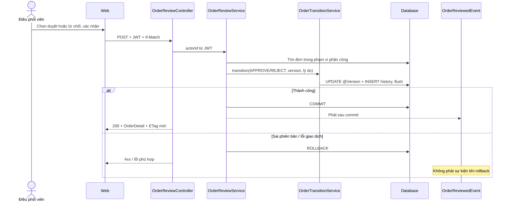

# 4.1 — Điều phối viên phê duyệt / từ chối đơn

Jira: [APDDMP-30](https://nnha90190-1791007728869.atlassian.net/browse/APDDMP-30).
Backend Java Spring Boot; UI React dùng API thật. Không thêm mã Flutter trong task này.

## Nghiệp vụ

- Chỉ DISPATCHER được quyết định, và chỉ đơn có trạm gửi **hoặc** trạm nhận nằm trong phân công của mình. Quy tắc này dùng chung OrderScopeResolver/OrderSpecs của 3.7.
- Không có phân công: danh sách rỗng, xem/xử lý đơn trả 404. Không tự cho tất cả điều phối viên thấy toàn bộ đơn.
- Duyệt: PENDING → APPROVED. Từ chối: PENDING → REJECTED, lý do 1–500 ký tự sau kiểm tra không rỗng; lưu bản đã bỏ khoảng trắng đầu/cuối.
- Danh tính người quyết định lấy từ JWT đã qua kiểm tra tài khoản, không lấy từ body.
- Chỉ OrderTransitionService được đổi status; không gán trực tiếp từ controller.
- Nếu đơn đã xử lý: 409 với phiên bản mới, 412 nếu client vẫn dùng phiên bản cũ.



## Hợp đồng HTTP

Base URL local: `http://localhost:5000/api`. Tất cả API cần Bearer token.

| API | Body | Header | Thành công |
|---|---|---|---|
| GET /v1/orders?status=PENDING | Không | Authorization | Danh sách phân trang trong phạm vi đã cấp |
| GET /v1/orders/{id} | Không | Authorization | OrderDetail và ETag |
| POST /v1/orders/{id}/approve | Không | Authorization, If-Match | 200 OrderDetail mới |
| POST /v1/orders/{id}/reject | `{"reason":"Hàng dễ vỡ, chưa đủ điều kiện vận chuyển"}` | Authorization, If-Match | 200 OrderDetail mới |

Ví dụ lấy `ETag: "0"` từ GET và gửi `If-Match: "0"` khi quyết định. Thành công trả `ETag: "1"`, `Cache-Control: no-store`.
CORS expose ETag/Location/Idempotent-Replayed cho origin được cấu hình; web không đoán phiên bản từ màn hình.

OrderDetail tiếp tục có id, version, status, statusLabel, hai stationId, recipient, package, history, createdAt, updatedAt. Lịch sử bổ sung `actorId` bên cạnh actorRole, source, reason và occurredAt để truy vết người thao tác. Giá trị thời gian theo ISO-8601.

| HTTP | Ý nghĩa / cách UI xử lý |
|---|---|
| 400 | Lý do thiếu/rỗng/quá dài, JSON không hợp lệ hoặc trường ngoài hợp đồng; sửa đầu vào |
| 401 | Chưa xác thực hoặc phiên hết hiệu lực |
| 403 | Role khác DISPATCHER |
| 404 | Đơn không tồn tại hoặc nằm ngoài phạm vi trạm; không phân biệt hai trường hợp |
| 409 | Chuyển trạng thái không hợp lệ; tải lại |
| 412 | Version conflict: người khác/khách hàng đã cập nhật; tải lại trước khi thử tiếp |
| 428 | Thiếu If-Match |

Không thêm cơ chế retry tự động cho quyết định. Nếu mạng lỗi sau lúc server đã commit, UI yêu cầu tải lại để biết kết quả trước khi tiếp tục.

## Transaction và sự kiện



OrderReviewedEvent chỉ phát sau commit. Payload gồm eventId (ID lịch sử), orderId, customerId, stationId gửi/nhận, version, trạng thái trước/sau, action, tên event, actorId/role, reason và occurredAt. Payload không mang địa chỉ/điện thoại.

4.3/4.4 dùng `@EventListener` để nhận sự kiện này; **không** dùng `@TransactionalEventListener(AFTER_COMMIT)` vì publisher đã thực hiện giai đoạn afterCommit. Consumer cần ghi database phải mở transaction mới (`REQUIRES_NEW`) hoặc chuyển vào hàng đợi riêng.

Đây là hook trong tiến trình, **chưa phải durable outbox/message broker**. Khi tiến trình chết sau commit, sự kiện có thể không tới consumer; lỗi listener được ghi log và không làm REST báo thất bại giả. Các task thông báo/realtime cần tự thiết kế retry/outbox nếu cần bảo đảm giao sự kiện. Lịch sử trong DB là nguồn dữ liệu bền vững để truy vết. REST 4.1 vẫn chạy khi chưa có consumer.

## Cấp phạm vi trạm

Thay TemporaryStaffStationScope bằng DatabaseStaffStationScope:
`staff_station_assignments(id, staff_id, station_id, assigned_at)`, khóa ngoại users/stations, unique(staff_id, station_id). Không có endpoint tự cấp quyền cho khách/nhân viên.

1. Môi trường dev dùng Hibernate ddl-auto=update: bảng được thêm khi khởi động. Môi trường quản lý schema thủ công: chạy `backend/scripts/4.1-staff-station-assignments.sql` trên SQL Server đúng database.
2. Quản trị viên xác định email DISPATCHER đang hoạt động và UUID trạm thực tế.
3. Điền hai biến trong `backend/scripts/4.1-assign-dispatcher.sql`, rồi chạy. Script kiểm tra role, tài khoản và trạm; không đổi role, không tự tạo người dùng.
4. Xóa đúng dòng phân công để thu hồi phạm vi; request tiếp theo kiểm tra lại database, không phải chờ JWT hết hạn.
5. Quyền quản lý trạng thái trạm 3.2 vẫn giữ nguyên; bảng này phục vụ phạm vi đọc đơn/xử lý đơn. Màn hình quản trị phân công chưa nằm trong 4.1.

Script schema cũng chuyển cột history.reason từ varchar sang nvarchar(500) nếu cần để giữ tiếng Việt. Test tự động dùng database riêng, không dùng database đang có dữ liệu thật: profile h2 dùng create-drop.

## Dùng giao diện

1. Đăng nhập tài khoản DISPATCHER đã cấp trạm.
2. Menu **Yêu cầu chờ duyệt** (`/dispatch/requests`) dùng lại danh sách 3.7, cố định trạng thái PENDING; vẫn có lọc mã/ngày/trạm và phân trang.
3. Mở chi tiết, kiểm tra người nhận/gói hàng/trạm.
4. **Duyệt đơn → Xác nhận duyệt**, hoặc **Từ chối đơn → nhập lý do → Xác nhận từ chối**. Có nút Quay lại trước khi gửi.
5. Sau thành công, trạng thái/lịch sử thay đổi từ dữ liệu API; nút xử lý biến mất. Khách xem lại đơn sẽ thấy kết quả và lý do.
6. Mở cùng đơn ở hai tài khoản/tab: người xử lý sau nhận thông báo xung đột và nút Tải lại đơn.
7. Tài khoản không đúng role không được vào trang chờ duyệt; backend vẫn kiểm tra quyền độc lập.

## Kiểm thử

Xem [báo cáo 4.1](../07-testing/APDDMP-30-report.md). Bộ test mới nằm tại
`backend/src/test/java/com/smartdrone/api/orders/OrderReviewIntegrationTest.java`.

```powershell
# Trong backend (dừng JAR đang chạy trước khi clean trên Windows)
mvn -B clean verify "-DforkCount=0"
# Chỉ test 4.1
mvn -B test "-DforkCount=0" "-Dtest=OrderReviewIntegrationTest"
# Trong web
npm ci
npm run build
```

Test mặc định H2/MSSQLServer mode. Muốn chạy bộ 4.1 trên SQL Server kiểm thử riêng: đặt REVIEW_TEST_DATABASE_URL, REVIEW_TEST_DATABASE_DRIVER=com.microsoft.sqlserver.jdbc.SQLServerDriver, REVIEW_TEST_DATABASE_USER, REVIEW_TEST_DATABASE_PASSWORD. **Database này sẽ bị create-drop bởi profile kiểm thử**, chỉ dùng database trống chuyên cho test. Không ghi mật khẩu vào repository.
