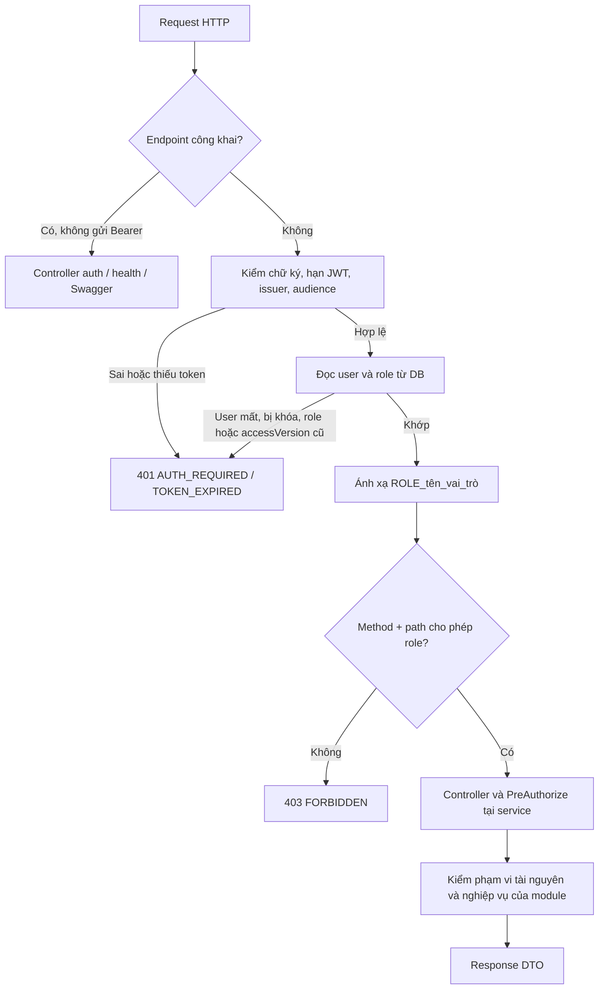

# Phân quyền 5 actor — Giai đoạn 2, mục 2.6 (APDDMP-18)

Ngày bàn giao: 02/11/2026. Người phụ trách: Lê Công Nhã.

## 1. Mục tiêu và căn cứ

Mục 2.5 trả lời **ai đang đăng nhập**. Mục 2.6 trả lời **người đó được phép làm gì**, kể cả khi họ bỏ qua giao diện và gọi HTTP trực tiếp.

Căn cứ [APDDMP-18](https://nnha90190-1791007728869.atlassian.net/browse/APDDMP-18),
[5 tác nhân APDDMP-3](https://nnha90190-1791007728869.atlassian.net/browse/APDDMP-3),
[hợp đồng endpoint APDDMP-9](https://nnha90190-1791007728869.atlassian.net/browse/APDDMP-9),
và code Java tại commit gốc `5caf2ea3298ad4068627b953a40434a6c685d7e4`.

Backend tiếp tục dùng Spring Boot 4.0.5, Spring Security, JPA, SQL Server và cấu trúc hiện có của nhóm.
Giữ mô hình **một tài khoản — một vai trò** của Java hiện tại. Tên `ADMIN` trong đặc tả được ánh xạ thành `SYSTEM_ADMIN` trong code/DB/JWT; không tạo vai trò thứ sáu.

## 2. Phạm vi đã triển khai

- 40 quy tắc HTTP method + path, mặc định từ chối endpoint chưa khai báo.
- Bật `@EnableMethodSecurity`; service quản lý quyền có `@PreAuthorize`.
- Kiểm JWT bằng bộ decoder hiện có; sau đó đối chiếu tài khoản, trạng thái, vai trò và phiên bản quyền trong DB.
- 4 API thực thi mới: xem quyền của tôi, danh mục 5 vai trò, danh sách tài khoản, thay đổi quyền/trạng thái tài khoản.
- Thay đổi quyền thu hồi refresh token và vô hiệu JWT cũ qua `accessVersion`.
- Ngăn Admin tự hạ quyền/tự khóa; cập nhật giống dữ liệu cũ không thu hồi phiên.
- Log `USER_ACCESS_CHANGED` gồm actorId, targetId, vai trò/trạng thái trước-sau và số phiên bị thu hồi; không log mật khẩu/token.
- Kiểm thử HTTP đi qua server Spring thật, JWT ký thật, JPA và DB; xem báo cáo kiểm thử trong `docs/07-testing`.

**Giới hạn rõ ràng:** đơn hàng, địa chỉ, trạm, file, analytics, AI và audit query chưa có controller nghiệp vụ ở commit gốc. Quy tắc RBAC cho các route này đã được chuẩn bị, nhưng không tạo dữ liệu hay giả vờ nghiệp vụ đã hoàn thành. Controller trả 204 dùng để kiểm tra filter chỉ nằm trong `src/test/java/rbacfixtures`, không có trong JAR chạy thật.

## 3. Ma trận quyền

`✓` là được qua lớp kiểm tra vai trò. Vẫn phải thỏa điều kiện dữ liệu/nghiệp vụ khi module tương ứng được xây dựng. `—` là bị chặn 403. Admin không tự động có quyền duyệt đơn, bàn giao hàng hay xem báo cáo.

| Nhóm thao tác | CUSTOMER | DISPATCHER | STATION_OPERATOR | LOGISTICS_MANAGER | SYSTEM_ADMIN |
|---|:---:|:---:|:---:|:---:|:---:|
| Xem quyền; hồ sơ cá nhân | ✓ | ✓ | ✓ | ✓ | ✓ |
| Xem danh sách trạm | ✓ | ✓ | ✓ | ✓ | ✓ |
| Quản lý địa chỉ của mình | ✓ | — | — | — | — |
| Tạo/sửa/hủy đơn của mình; xem mã nhận | ✓ | — | — | — | — |
| Xem đơn, tracking, ETA theo phạm vi | ✓ | ✓ | ✓ | ✓ | — |
| Duyệt/từ chối, lên lịch, xử lý thất bại/hoàn | — | ✓ | — | — | — |
| Nhận kiện, xuất phát, nhận đích, bàn giao, nhận hoàn | — | — | ✓ | — | — |
| Tạo/sửa thông tin trạm | — | — | — | ✓ | — |
| Cập nhật trạng thái trạm | — | — | Chưa cấp đến khi có phân công | ✓ | — |
| Availability/sức chứa theo lịch | Chưa triển khai | Chưa triển khai | Chưa triển khai | Chưa triển khai | Chưa triển khai |
| Thống kê giao hàng | — | — | — | ✓ | — |
| Tóm tắt đơn | ✓ | ✓ | — | ✓ | — |
| Trợ lý khách hàng | ✓ | — | — | — | — |
| Xin upload ảnh | ✓ | — | ✓ | — | — |
| Xin link tải ảnh theo phạm vi | ✓ | ✓ | ✓ | — | — |
| Xem user/role, cấp quyền, khóa/mở khóa, audit | — | — | — | — | ✓ |

Danh sách chính xác từng method/path: `RbacPolicy.java`. Ma trận kiểm thử độc lập: `backend/src/test/resources/rbac-matrix.csv`.

APDDMP-3 ghi một số quyền `O*` chưa chi tiết. Bản này dùng APDDMP-9 để chốt thao tác cụ thể; ví dụ Admin không được tự bàn giao thay operator. Mô hình nhiều vai trò và quan hệ phân công trạm chưa được bổ sung trong 2.6 vì code Java hiện tại chưa có các bảng đó.
Task 3.2 hiện triển khai CRUD trạm và từ chối thao tác đổi trạng thái của operator cho tới khi có mô hình phân công. API availability chưa được triển khai.

## 4. Luồng kiểm tra



JWT gửi kèm dù ở endpoint công khai vẫn được Spring kiểm tra. Với login/refresh/logout, gửi request không kèm access token hết hạn.

```mermaid
sequenceDiagram
    participant A as Admin
    participant S as Spring Security
    participant U as UserAccessService
    participant DB as SQL Server
    A->>S: PATCH /api/v1/users/id/access
    S->>DB: Đọc tài khoản Admin và phiên bản quyền
    S->>U: ROLE_SYSTEM_ADMIN hợp lệ
    U->>DB: Khóa dòng SYSTEM_ADMIN; đọc lại quyền người gọi
    U->>U: Kiểm user đích, payload, không tự khóa/hạ quyền
    U->>DB: Đổi role/enabled, tăng access_version
    U->>DB: Thu hồi mọi refresh token của user đích
    U-->>A: 200 UserAccessView (không có bí mật)
    Note over S,DB: JWT cũ của user đích bị từ chối ở request kế tiếp
```

## 5. API thực thi trong 2.6

Base URL mặc định: `http://localhost:5000/api`.

| Method | Path | Quyền | Thành công |
|---|---|---|---|
| GET | `/v1/me/permissions` | Cả 5 vai trò | 200 `MyPermissions` |
| GET | `/v1/roles` | SYSTEM_ADMIN | 200 danh sách đúng 5 `RoleAccess` |
| GET | `/v1/users?page=1&pageSize=20` | SYSTEM_ADMIN | 200 `UserAccessPage` |
| PATCH | `/v1/users/{id}/access` | SYSTEM_ADMIN | 200 `UserAccessView` |

Tất cả response thành công trên có `Cache-Control: no-store`. ID là UUID. Không trả entity JPA, passwordHash hay refresh token.

### Xem quyền hiện tại

```json
{
  "userId": "11111111-1111-1111-1111-111111111111",
  "role": "DISPATCHER",
  "allowedEndpoints": [
    {"method": "GET", "path": "/v1/me/permissions"},
    {"method": "POST", "path": "/v1/orders/{id}/approve"}
  ]
}
```

Ví dụ đã rút gọn danh sách. Path không chứa context-path `/api`. Danh sách này mô tả chính sách, không phải danh sách chức năng đã xây xong hoặc quyền trên mọi bản ghi.

### Danh mục vai trò

Mỗi phần tử có `role`, `displayName`, `allowedEndpoints`. Chỉ Admin được xem toàn bộ danh mục. Web/mobile dùng `/me/permissions` cho tài khoản thông thường.

### Danh sách user

`page` bắt đầu từ 1; `pageSize` từ 1 đến 100. Sắp xếp `createdAt DESC`, sau đó `id` để thứ tự ổn định. Response gồm `items`, `page`, `pageSize`, `total`. Item gồm `id`, `email`, `fullName`, `role`, `enabled`, `createdAt`.

### Cấp/thu hồi quyền

```json
{"role": "DISPATCHER", "enabled": true}
```

- Có thể chỉ gửi `role` hoặc `enabled`. Trường thiếu hoặc null giữ nguyên.
- `{}` hoặc cả hai null → 400; role ngoài 5 giá trị → 400. `ADMIN` không phải giá trị hợp lệ; dùng `SYSTEM_ADMIN`.
- User đích không tồn tại → 404. Các vai trò khác bị chặn trước khi truy vấn user đích.
- Admin thay đổi quyền/trạng thái chính mình → 409 `SELF_ACCESS_CHANGE`. Gửi lại đúng trạng thái đang có được trả 200 và không thu hồi phiên.
- Thay đổi thật: cập nhật trong transaction, tăng `access_version`, thu hồi tất cả refresh token. User đăng nhập lại để lấy JWT với quyền mới.
- Khóa/mở khóa không làm token cũ sống lại. Cấp lại vai trò cũ cũng không làm token cũ sống lại.
- Các lệnh sửa quyền tuần tự qua khóa dòng vai trò SYSTEM_ADMIN; service đọc lại người gọi sau khi giữ khóa. Hai Admin không thể đồng thời hạ quyền nhau dựa trên quyền cũ.

### Mã lỗi chính

| HTTP | code | Ý nghĩa |
|---|---|---|
| 400 | VALIDATION_ERROR | JSON/role/payload/phân trang sai |
| 401 | AUTH_REQUIRED | Không có JWT hợp lệ; user đã mất/bị khóa hoặc quyền/token version không còn khớp |
| 401 | TOKEN_EXPIRED | Access token hết hạn |
| 403 | FORBIDDEN | Đã xác thực nhưng sai vai trò hoặc route chưa được cấp quyền |
| 404 | RESOURCE_NOT_FOUND | Admin sửa user không tồn tại |
| 409 | SELF_ACCESS_CHANGE | Admin tự khóa/hạ quyền |

Login tài khoản đang khóa vẫn dùng lỗi `403 ACCOUNT_LOCKED` của 2.5. Refresh đã bị thu hồi dùng `401 INVALID_REFRESH_TOKEN`. Lỗi có `status`, `code`, `message`, `detail`, `traceId` như auth hiện tại.

## 6. Thay đổi dữ liệu và tương thích

Thêm `users.access_version BIGINT NOT NULL DEFAULT 0`. Cấu hình `ddl-auto=update` hiện có của nhóm bổ sung cột lúc khởi động trên DB dev. Không thay bảng role, không đổi sang nhiều vai trò, không sửa migration .NET cũ.

JWT mới có claim `accessVersion`. JWT 2.5 thiếu claim này chỉ được chấp nhận nếu tài khoản vẫn ở version 0, role khớp và tài khoản đang bật. Khi quyền thay đổi, token cũ bị từ chối kể cả lúc role được cấp lại.

Để có Admin đầu tiên: đăng ký một tài khoản bình thường, sửa biến `@admin_email` trong `backend/scripts/bootstrap-admin.sql` thành email đã xác minh, rồi **người quản trị DB** chạy script. Script chỉ cấp tài khoản đầu tiên khi chưa có Admin đang hoạt động, không có mật khẩu mặc định và không có API public tự nâng quyền. Những lần cấp quyền tiếp theo dùng API của Admin.

```powershell
# Chỉ trên database dev của nhóm sau khi app đã khởi tạo schema.
# Email được sửa trong biến @admin_email của script trước khi chạy.
sqlcmd -S localhost -U sa -P "$env:MSSQL_SA_PASSWORD" -C -d smartdrone `
  -i backend/scripts/bootstrap-admin.sql
```

Kết quả `promoted_accounts = 1` là đã cấp; `0` nghĩa là đã có Admin hoặc email không khớp tài khoản đang bật. Đăng nhập lại sau khi cấp.

## 7. Hướng dẫn demo

1. Dùng JDK 21+ và Maven 3.9+. Tại thư mục gốc chạy `mvn -B -f backend/pom.xml verify`.
2. Chạy SQL Server dev theo `docker-compose.yml`, rồi `mvn -f backend/pom.xml spring-boot:run`. Hoặc dùng profile RAM: `mvn -f backend/pom.xml spring-boot:run "-Dspring-boot.run.profiles=h2"`.
3. Mở `http://localhost:5000/api/swagger-ui.html`. Nhóm **Access** hiển thị 4 endpoint của 2.6.
4. Đăng ký khách hàng, login, lấy accessToken. Trong Swagger chọn Authorize và nhập accessToken.
5. Gọi `/me/permissions` → CUSTOMER, 200. Gọi `/users` → 403.
6. Với Admin đã được cấp qua DB, login rồi dùng `/roles`, `/users` và PATCH `/users/{id}/access`.
7. Cấp DISPATCHER cho tài khoản khách hàng. JWT khách hàng cũ gọi API → 401. Login lại → `/me/permissions` hiển thị DISPATCHER.
8. Khóa user; JWT đã cấp bị từ chối. Mở lại user; JWT cũ vẫn bị từ chối, cần login lại.

Ví dụ request để dùng với REST Client/Postman: `rbac-demo.http`. Kiểm thử tự động tự tạo tài khoản 5 vai trò trong DB test; không tạo tài khoản mẫu/mật khẩu chung trong DB nhóm.

## 8. Phối hợp các mục sau

- **2.7:** `/v1/me` GET/PATCH và POST `/v1/me/password` đã có quy tắc cho 5 role. GET/PATCH hồ sơ vẫn do 2.7 triển khai. Khi đổi mật khẩu, cần tăng accessVersion và thu hồi refresh token theo chính sách đã thống nhất.
- **2.8:** gọi `/me/permissions` hoặc dùng `user.role` từ login để hiển thị menu. Xử lý 403 là thiếu quyền, 401 là phiên không hợp lệ. UI ẩn menu không thay thế phân quyền API.
- **Giai đoạn 3–5:** sau khi role được phép, lọc query theo chủ sở hữu/tổ chức/trạm. Customer không đọc đơn người khác; operator không thao tác ở trạm khác. Theo APDDMP-9, tài nguyên ngoài phạm vi trả 404. Các kiểm thử scope này chưa thể thực hiện khi entity/controller nghiệp vụ chưa tồn tại.
- Endpoint mới phải thêm rule method/path và test độc lập; nên bổ sung `@PreAuthorize` ở service. `/integration/**` bị chặn cho 5 actor cho đến khi có cơ chế xác thực service riêng.
- Hiện log thay đổi quyền là application log, không phải kho audit DB bất biến. API audit, chính sách lưu log, TLS, secret production, rate limiting và hiệu năng toàn hệ thống thuộc bước triển khai/kiểm thử sau.

## 9. Sửa lỗi tích hợp tối thiểu

Commit gốc không compile vì `ApiException.java` chứa hai class cùng tên. Ngoài ra có hai `GlobalExceptionHandler` cùng tên bean.

Bản này gộp ApiException thành một class, giữ tương thích cả constructor `HttpStatus` của middleware và `ErrorCode` của auth; giữ một advice chuẩn ProblemDetail xử lý cả 401/403. Bộ handler trùng trong `api/exception` được bỏ. Không viết lại kiến trúc Java 2.1 hay sửa phần UI của các thành viên khác.

README gốc còn lệnh `dotnet run` đã cũ; lệnh đúng cho phần Java được ghi tại mục 7 ở trên. README gốc được giữ nguyên theo phạm vi giao việc.

## 10. Tài liệu framework

- [Spring Security — quyền theo HTTP request](https://docs.spring.io/spring-security/reference/servlet/authorization/authorize-http-requests.html).
- [Spring Security — method security và EnableMethodSecurity](https://docs.spring.io/spring-security/reference/servlet/authorization/method-security.html).
