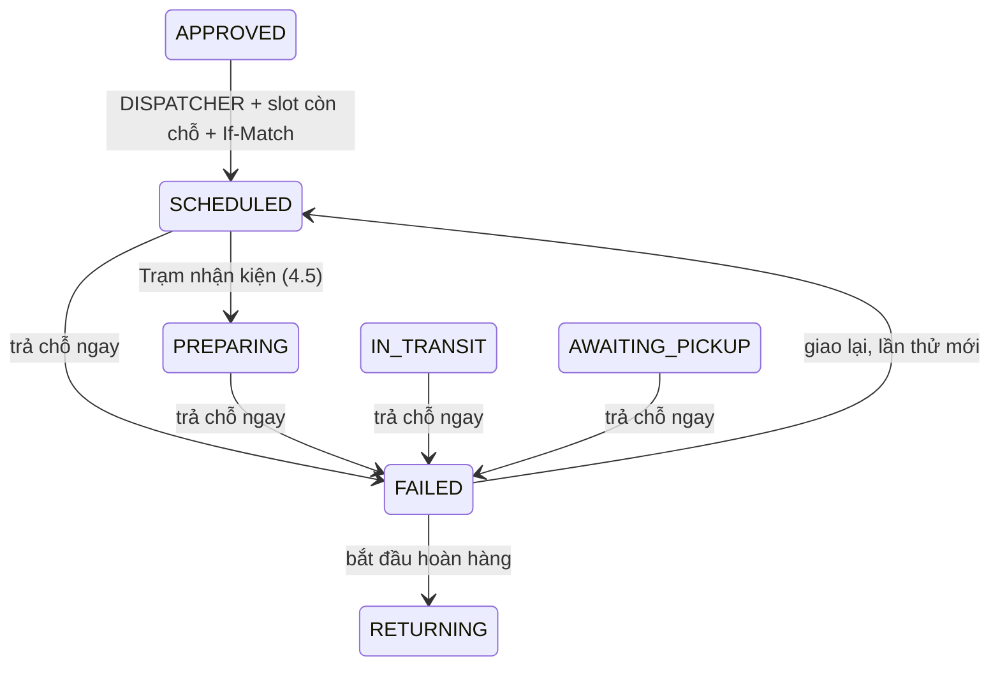
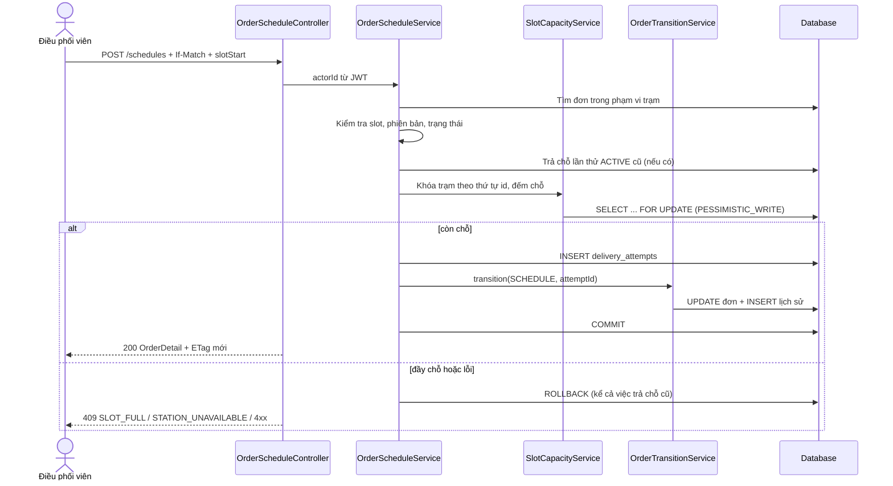

# 4.2 — Điều phối viên lên lịch giao hàng và kiểm tra sức chứa

Jira: [APDDMP-31](https://nnha90190-1791007728869.atlassian.net/browse/APDDMP-31).
Backend Java Spring Boot; web React dùng chung API này (`OrderScheduleActions.tsx`). Mobile Flutter chưa có màn hình lịch, chỉ cần dùng lại API.

## Quyết định

| Nội dung | Quyết định | Trạng thái |
|---|---|---|
| Đơn vị tính sức chứa | Theo lần lên lịch (mỗi `delivery_attempts` đang ACTIVE chiếm 1 chỗ ở mỗi trạm), không theo số kiện | Chờ nhóm xác nhận |
| Trạm bị tính | Cả trạm gửi và trạm nhận; nếu trùng nhau chỉ chiếm 1 chỗ | Đã cài đặt |
| Khung giờ | Slot 30 phút trên lưới UTC, đặt sớm nhất 30 phút, xa nhất 7 ngày (cấu hình `app.schedule`) | Đã cài đặt |
| Khi nào trả chỗ | Ngay khi đơn chuyển sang FAILED hoặc RETURNING (trong `OrderTransitionService`, cùng transaction); khi giao lại, chỗ cũ còn sót cũng được trả trước khi đếm | Đã cài đặt |
| Đơn đã SCHEDULED | Không có đổi lịch hay hủy trực tiếp trong 4.2 (state machine 3.5 không có cạnh này; khách chỉ hủy đơn PENDING). Muốn đổi lịch thì đánh dấu thất bại (FAIL, có lý do) rồi giao lại; chỗ được trả theo dòng trên | Chờ nhóm xác nhận |
| Slot sau khi giao xong | Attempt vẫn ACTIVE nhưng không còn tính vào slot nào đang mở vì khung giờ đã qua | Đã cài đặt |
| Phạm vi xem chỗ trống | Chỉ xem trạm mình được phân công, hoặc trạm còn lại của đơn nằm trong phạm vi của mình; ngoài ra 404 | Đã cài đặt |

## Nghiệp vụ

- Chỉ DISPATCHER được lên lịch, và chỉ đơn trong phạm vi trạm của mình (cùng `OrderScopeResolver`/`OrderSpecs` với 4.1). Ngoài phạm vi: 404.
- Lên lịch: APPROVED → SCHEDULED. Giao lại sau thất bại: FAILED → SCHEDULED, dùng chính API này. Cả hai cạnh đều do `TransitionRules` của 3.5 quy định và đều bắt buộc có `attemptId`.
- Mỗi lần lên lịch tạo một dòng `delivery_attempts` mới (`attempt_no` tăng dần); id của dòng đó là `attemptId` ghi vào lịch sử đơn. Không sửa hay dùng lại dòng cũ.
- Một lần lên lịch **giữ 1 chỗ ở trạm gửi và 1 chỗ ở trạm nhận** trong khung giờ. Nếu hai trạm trùng nhau chỉ giữ 1 chỗ.
- Sức chứa (`stations.capacity`) là số chỗ giữ đồng thời tại trạm trong một khung giờ. Lịch được nhận khi số lần giữ chỗ ACTIVE chồng lên khung giờ ở **mỗi** trạm nhỏ hơn sức chứa.
- Trạm phải ở trạng thái ACTIVE; ngược lại trả 409 `STATION_UNAVAILABLE`.
- Chỉ OrderTransitionService được đổi trạng thái đơn; service lên lịch không tự gán status.



## Quy tắc khung giờ

Cấu hình trong `application.yml`, nhóm `app.schedule` (thiếu hoặc sai thì backend không khởi động):

| Khóa | Mặc định | Ý nghĩa |
|---|---|---|
| `slot-minutes` | 30 | Độ dài một slot, phải chia hết 1440 (hoạt động 24/24) |
| `min-lead-minutes` | 30 | Lịch phải bắt đầu sau hiện tại ít nhất ngần này phút |
| `max-days-ahead` | 7 | Đặt xa nhất bao nhiêu ngày |

- `slotStart` là thời điểm UTC (ISO-8601, ví dụ `2026-11-17T03:00:00Z`), phải trùng mốc đầu slot, không có phần lẻ giây.
- Mốc slot tính theo UTC. Với slot 15, 30 hoặc 60 phút thì trùng với giờ Việt Nam; không nên dùng 45 hay 90 phút.
- Giới hạn gần nhất và xa nhất là bao gồm hai đầu.

## Hợp đồng HTTP

Base URL local: `http://localhost:5000/api`. Tất cả API cần Bearer token.

| API | Quyền | Header | Thành công |
|---|---|---|---|
| POST /v1/orders/{id}/schedules | DISPATCHER | Authorization, If-Match | 200 OrderDetail mới, ETag mới |
| GET /v1/stations/{id}/availability?date=yyyy-MM-dd | DISPATCHER, STATION_OPERATOR, LOGISTICS_MANAGER (trong phạm vi trạm) | Authorization | 200 StationAvailabilityView |

### Lên lịch

```json
{"slotStart": "2026-11-17T03:00:00Z"}
```

Lấy `ETag` từ `GET /v1/orders/{id}`, gửi lại ở `If-Match`. Thành công trả `OrderDetail` có `status = SCHEDULED`, `version` tăng 1, lịch sử có dòng mới kèm `attemptId`. Response có `Cache-Control: no-store`.

### Xem chỗ còn trống

`date` theo giờ Việt Nam; bỏ trống là hôm nay. Kết quả gồm `stationId`, `stationName`, `stationStatus`, `capacity`, `slotMinutes`, `date`, `timeZone` và mảng `slots`. Mỗi slot có `slotStart`, `slotEnd`, `used`, `free`, `bookable`.

`bookable = true` khi trạm ACTIVE, `free > 0` và slot nằm trong khoảng cho phép đặt. Với slot 30 phút, một ngày có 48 slot; slot đầu của ngày 17/11 có `slotStart = 2026-11-16T17:00:00Z`.

Phạm vi: người gọi xem được trạm nếu trạm đó nằm trong các trạm được phân công cho họ, hoặc là trạm gửi/nhận của một đơn nằm trong phạm vi của họ (để lịch đơn liên trạm vẫn xem được trạm đối tác). Ngoài ra trả 404, giống quy ước của đơn hàng, không phân biệt trạm không tồn tại với trạm ngoài phạm vi.

## Mã lỗi

| HTTP | code | Ý nghĩa / cách UI xử lý |
|---|---|---|
| 400 | VALIDATION_ERROR | Thiếu `slotStart`, lệch mốc, quá gần, quá xa, JSON sai |
| 401 | AUTH_REQUIRED | Chưa đăng nhập hoặc phiên hết hiệu lực |
| 403 | FORBIDDEN | Không đúng vai trò |
| 404 | RESOURCE_NOT_FOUND | Đơn ngoài phạm vi trạm hoặc không tồn tại; trạm không tồn tại hoặc ngoài phạm vi (availability) |
| 409 | INVALID_STATE_TRANSITION | Đơn không ở trạng thái cho phép lên lịch |
| 409 | SLOT_FULL | Khung giờ đã đủ chỗ ở trạm gửi hoặc trạm nhận; chọn slot khác |
| 409 | STATION_UNAVAILABLE | Trạm gửi hoặc nhận không hoạt động |
| 412 | VERSION_CONFLICT | Đơn vừa được cập nhật, hoặc có người vừa lên lịch cùng đơn; tải lại |
| 428 | PRECONDITION_REQUIRED | Thiếu If-Match |

Thứ tự kiểm tra: phạm vi (404) → `slotStart` (400) → phiên bản (412) → trạng thái (409) → trạm và sức chứa (409).

## Transaction và chống đặt vượt chỗ



- Khóa dòng trạm luôn theo thứ tự `id` để hai điều phối viên đặt chéo trạm không khóa lẫn nhau.
- Việc đếm chỗ, ghi `delivery_attempts` và đổi trạng thái nằm trong cùng một transaction: thất bại thì không còn dòng giữ chỗ nào.
- Ràng buộc duy nhất `(order_id, attempt_no)` là lớp chặn cuối khi hai người lên lịch cùng một đơn.

## Trả chỗ khi thất bại

`OrderTransitionService.transition()` gọi `AttemptReleaseService.releaseActive(orderId)` ngay sau khi ghi lịch sử, nếu trạng thái đích là `FAILED` hoặc `RETURNING`. Việc trả chỗ và đổi trạng thái nằm chung một transaction: transaction bị hủy thì chỗ vẫn được giữ (có test). `releaseActive` chạy lại nhiều lần không sao.

## Bàn giao cho các task khác

- **4.8 (thất bại, giao lại):** không cần tự gọi `releaseActive`; chuyển đơn sang FAILED qua `OrderTransitionService` là chỗ tự được trả. Giao lại dùng lại `POST /schedules`; chỗ cũ đã được trả nên slot cũ đặt lại được.
- **4.5 (nhận kiện):** trạng thái SCHEDULED và `attemptId` trong lịch sử là đầu vào.
- **5.1 (dữ liệu tải trạm):** dùng `GET /v1/stations/{id}/availability` (`used`, `free` theo slot) trong phạm vi quyền ở trên.
- **Realtime:** mỗi lần chuyển trạng thái (kể cả SCHEDULE) `OrderTransitionService` phát `OrderStatusChanged`; listener chỉ đẩy ra WebSocket sau khi commit.

## Dữ liệu

Bảng `delivery_attempts` do Hibernate `ddl-auto=update` tạo khi khởi động. Môi trường quản lý schema thủ công chạy `backend/scripts/4.2-delivery-attempts.sql` (có thể chạy lại nhiều lần).

## Dùng thử trên Swagger

1. Đăng nhập tài khoản DISPATCHER đã được cấp trạm (cách cấp: xem `order-review-api.md`).
2. Duyệt một đơn PENDING, hoặc dùng đơn đã APPROVED; lấy `ETag` từ `GET /v1/orders/{id}`.
3. Gọi `GET /v1/stations/{id}/availability?date=...` để chọn slot có `bookable = true`.
4. Gọi `POST /v1/orders/{id}/schedules` với `slotStart` đó.
5. Gọi lại availability: slot vừa đặt phải có `used` tăng 1, `free` giảm 1.
6. Đặt thêm đơn vào cùng slot khi `free = 0` để thấy 409 `SLOT_FULL`.

## Kết quả kiểm thử

Chạy ngày 20/11/2026 trên H2 (`mvn -B test "-DforkCount=0"`), 0 lỗi, 0 bỏ qua:

- `OrderScheduleIntegrationTest` (server Spring thật, JWT thật, H2 riêng): **23 lượt chạy**. Gồm: lên lịch thành công và lịch sử, số chỗ đã đặt/còn trống theo từng slot, `SLOT_FULL` ở trạm gửi và trạm nhận, trạm không hoạt động, đầu vào sai (428/400/412), trạng thái và phạm vi (409/404), quyền của các vai trò, giao lại giải phóng chỗ cũ, trả chỗ một lần, rollback, hai đơn tranh chỗ cuối (đúng một đơn thắng, lặp 3 lần), FAILED trả chỗ ngay (kể cả từ IN_TRANSIT), rollback của FAIL không làm mất chỗ, `attemptId` trong lịch sử và giao lại tạo attempt mới, availability lọc theo trạm được phân công và hiển thị trạm đối tác của đơn.
- `OrderTransitionServiceTest`: 9/9.
- `RbacIntegrationTest`: 238/238.
- `ScheduleSlotPolicyTest`: 10/10 (chạy ngày 17/11).

```powershell
mvn -B test "-DforkCount=0" "-Dtest=OrderScheduleIntegrationTest,OrderTransitionServiceTest,RbacIntegrationTest,ScheduleSlotPolicyTest"
```

## Chưa kiểm chứng

- Test chạy trên H2. **Chưa chạy trên SQL Server thật**: khóa dòng `PESSIMISTIC_WRITE` và hành vi tranh chấp cần kiểm trên database test riêng.
- Chưa gọi tay qua Swagger với dữ liệu trên máy dev.
- Chưa build web và thao tác giao diện chọn slot với API thật; web chưa có test tự động.
- Hai quyết định đánh dấu "Chờ nhóm xác nhận" ở đầu tài liệu.